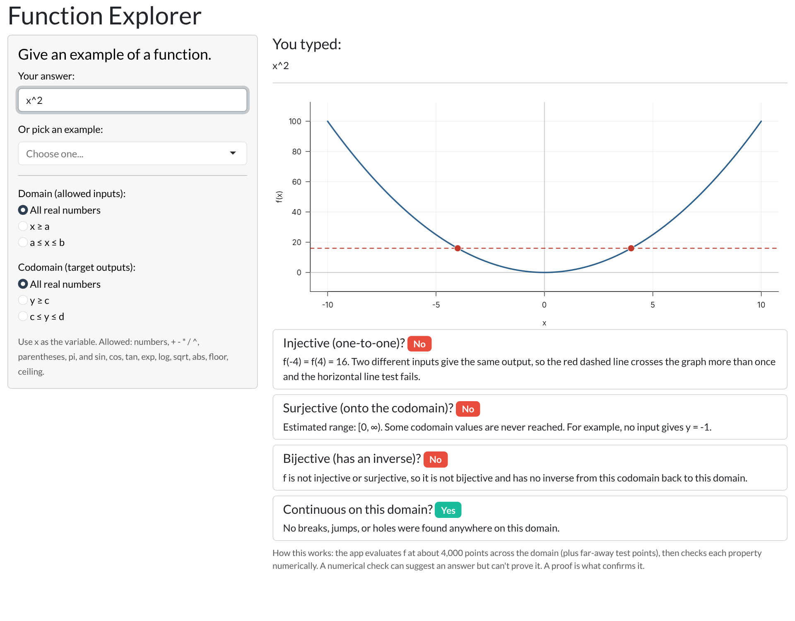
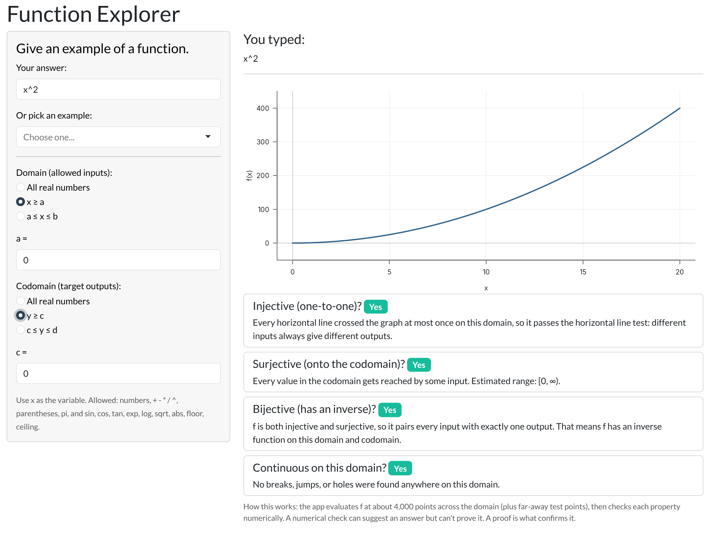
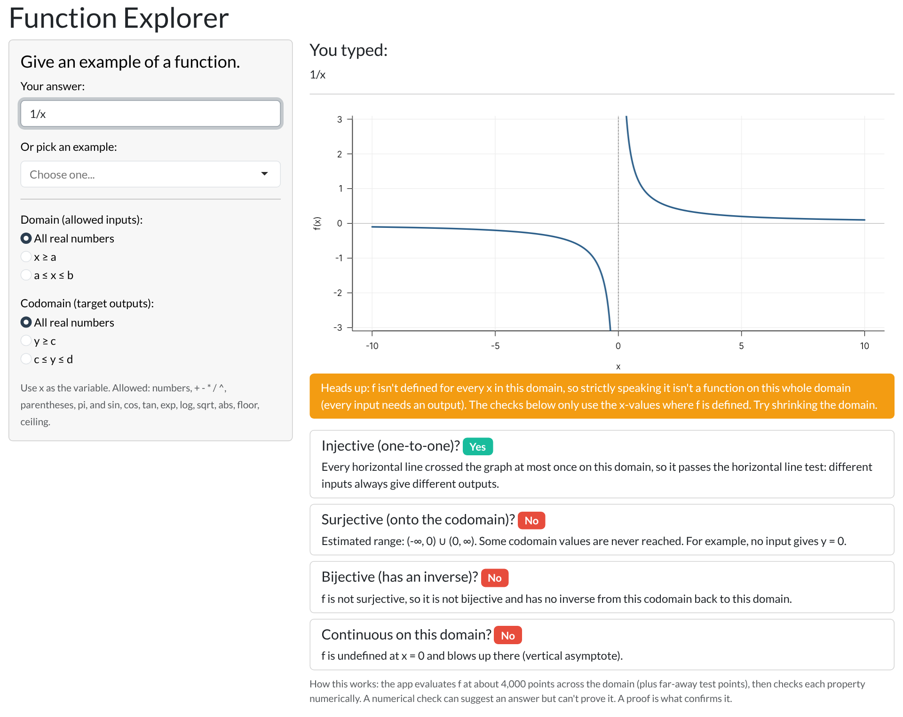

# Function Explorer

**An interactive R Shiny app that graphs any function you type and checks whether it is injective, surjective, bijective, and continuous.**

**Try it live:** https://kelseybivens.shinyapps.io/FunctionExplorer/

**Full report:** [Function Explorer: Checking Function Properties with Proofs and an App](REPORT.md)

*(The app may take a few seconds to wake up on the first visit.)*

---

## What it does

The app asks one question: **"Give an example of a function."** Type any formula, such as `4x + 2`, `x^2`, or `1/x`, and the app will:

1. **Show exactly what you typed**, the original requirement of the assignment.
2. **Graph the function.**
3. **Let you choose the domain and codomain**: all real numbers, x ≥ a, or a ≤ x ≤ b (and the same options for outputs).
4. **Check four properties** and explain each answer in plain language:

| Property | What the app checks | How it shows it |
|---|---|---|
| **Injective** (one-to-one) | Do two different inputs ever give the same output? | Draws a red horizontal line through two matching points when the test fails |
| **Surjective** (onto) | Does the range cover the whole codomain? | Reports the estimated range and names a value that is never reached |
| **Bijective** | Is it both? If so, the function has an inverse | Combines the two results above |
| **Continuous** | Are there any jumps, holes, or vertical asymptotes? | Marks each break on the graph with a dotted line |

## Why I built it

Injectivity, surjectivity, and continuity are usually taught with proofs and a few hand-drawn graphs. Students often memorize the definitions without seeing *why* a parabola fails the horizontal line test or *how* restricting the domain changes the answer. This app lets a learner change one setting and immediately watch the result change.

For example, `x^2` on all real numbers is **not** injective, because f(-4) = f(4) = 16. Restrict the domain to x ≥ 0 and the codomain to y ≥ 0, and the same formula becomes **bijective**, with inverse √y:

## How it works

The app turns each definition into something a computer can test:

- **Sampling:** It evaluates the function at about 4,000 points across the domain, plus test points far out toward infinity.
- **Injective:** It draws horizontal lines across the graph and looks for any line that crosses the graph twice (the horizontal line test).
- **Surjective:** It estimates the range of each unbroken piece of the graph, combines them, and checks whether they cover the codomain.
- **Continuous:** It looks for unusually large jumps between neighboring points, then zooms in twice. A continuous function's jumps shrink when you zoom in; a true break does not.

**Important limitation:** These are numerical checks on a finite set of points. They can strongly *suggest* an answer, but they cannot *prove* one. A function could behave differently between sample points or far beyond them. That is exactly why mathematical proofs still matter, and the full report compares the app's results with formal proofs.

## Files

| File | Description |
|---|---|
| `REPORT.md` | The full modeling report: formulation, proofs, results, and limitations |
| `app.R` | The Function Explorer app (current version) |
| `FunctionExample.R` | The original version: a prompt, a text box, and an echo of the user's answer |

## Run it yourself

1. Install [R](https://cran.r-project.org/) and [RStudio](https://posit.co/download/rstudio-desktop/).
2. In the RStudio Console, run `install.packages(c("shiny", "bslib"))`.
3. Open `app.R` and click **Run App**.

## Author

**Kelsey Bivens**
B.A.S. in Mathematics, Minor in Psychology
Built with R, Shiny, and AI-assisted development.
